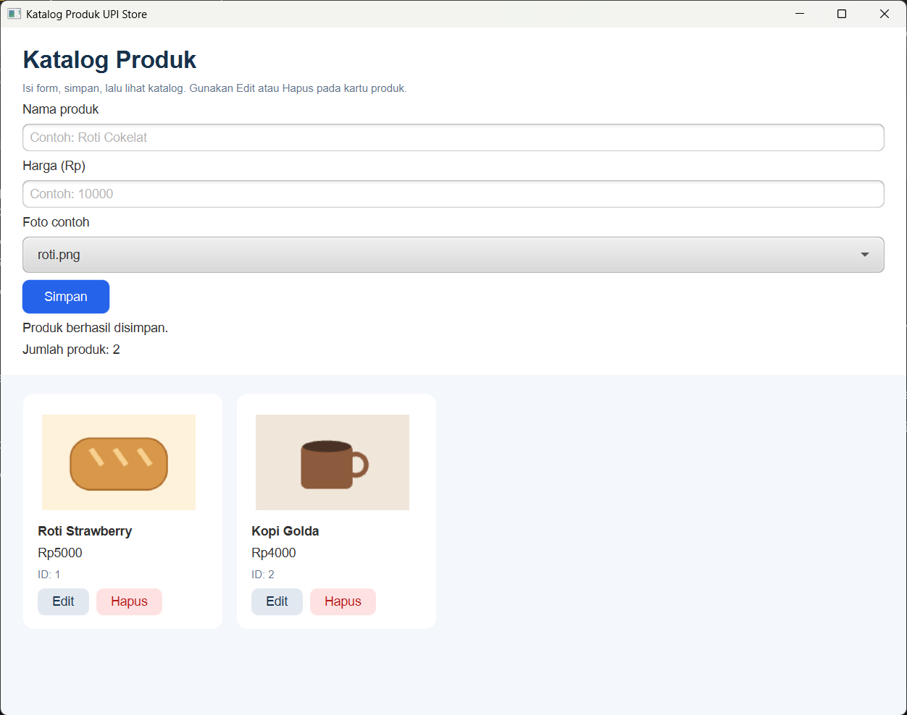

# Katalog Produk

Aplikasi desktop sederhana untuk mengelola katalog produk, dibuat dengan **JavaFX** dan **SQLite**. Mendukung operasi CRUD lengkap: tambah, tampil, ubah, dan hapus produk.



## Fitur

- **Tambah produk**: isi nama, harga, dan pilih foto, lalu klik **Simpan**.
- **Tampil katalog**: produk tampil sebagai kartu berisi foto, nama, harga, dan ID.
- **Ubah produk**: klik **Edit** pada kartu, ubah datanya di form, lalu klik **Perbarui** (atau **Batal** untuk membatalkan).
- **Hapus produk**: klik **Hapus** pada kartu, lalu konfirmasi pada dialog yang muncul.
- **Validasi input**: nama wajib diisi, harga harus angka bulat lebih dari nol, dan foto wajib dipilih.

## Teknologi

- Java 17
- JavaFX 21 (controls dan FXML)
- SQLite (`sqlite-jdbc` 3.49.1.0)
- Maven

## Struktur Proyek

```
KatalogProduk/
├── pom.xml
└── src/main/
    ├── java/
    │   ├── main/MainApp.java                  # titik masuk aplikasi
    │   ├── model/Produk.java                  # model data + validasi
    │   ├── data/ProdukRepository.java         # akses database (add, update, delete, getAll)
    │   ├── db/Database.java                   # koneksi dan pembuatan tabel SQLite
    │   └── controller/KatalogController.java  # logika antarmuka
    └── resources/
        ├── view/katalog.fxml                  # tata letak antarmuka
        ├── view/styles/app.css                # gaya tampilan
        └── image/                             # foto contoh (roti, susu, kopi)
```

## Cara Menjalankan

Prasyarat: **JDK 17 atau lebih baru** dan **Maven** sudah terpasang.

```bash
git clone https://github.com/Oliver-ist/KatalogProduk.git
cd KatalogProduk
mvn javafx:run
```

Database SQLite dibuat otomatis di `data/katalog.db` saat aplikasi pertama kali dijalankan, jadi tidak perlu pengaturan tambahan.
